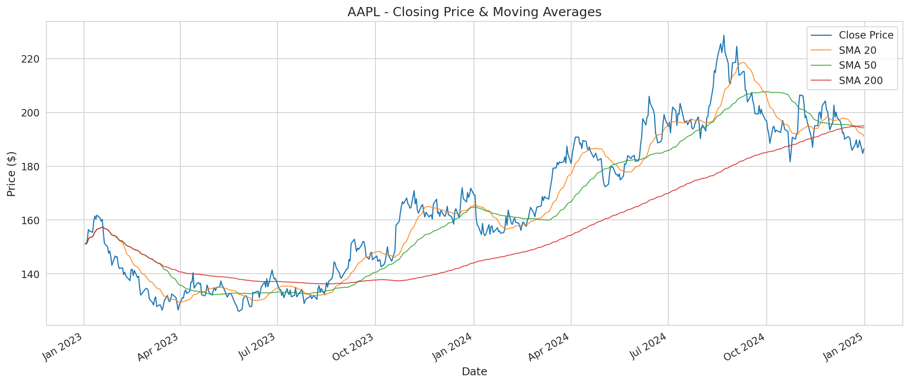
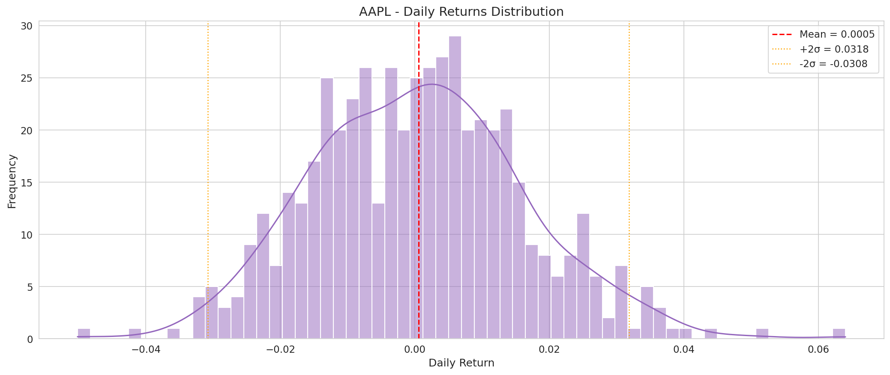
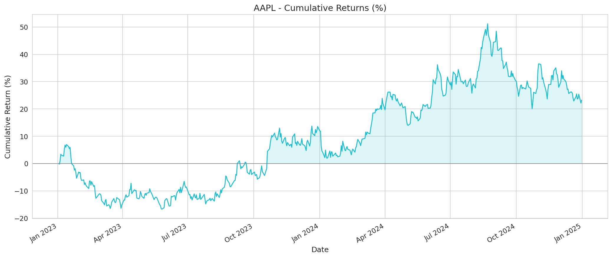
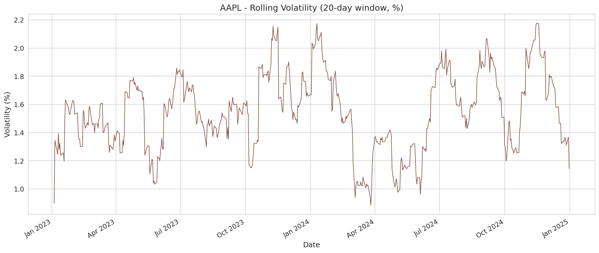
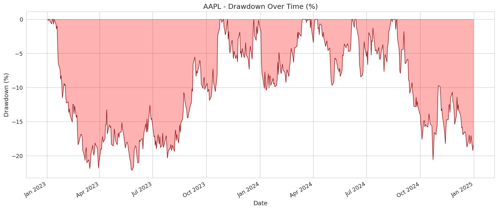
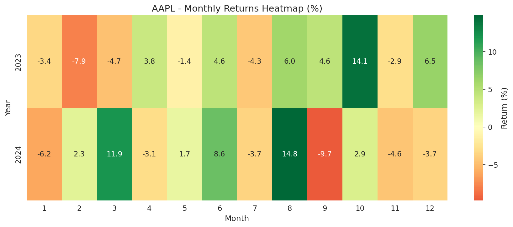

# 📈 Stock Market Data Analyzer


> **One command. Any ticker. Full analysis.**  
> A beginner-friendly Python tool that turns free public stock data into clean charts, risk metrics, and a plain-English report — no Bloomberg terminal required.

---

<p align="center">
  <a href="#-quick-start">⚡ Quick Start</a> &nbsp;·&nbsp;
  <a href="#-what-it-does">What It Does</a> &nbsp;·&nbsp;
  <a href="#-sample-output">Sample Output</a> &nbsp;·&nbsp;
  <a href="#-gallery">Gallery</a> &nbsp;·&nbsp;
  <a href="#-architecture">Architecture</a> &nbsp;·&nbsp;
  <a href="#-learning-outcomes">Learning Outcomes</a> &nbsp;·&nbsp;
  <a href="#-documentation">Docs</a>
</p>

---

## 🎯 Why this project exists

Students and junior analysts rarely have access to Bloomberg or Reuters terminals. This project proves you can build a **working stock-analysis tool** with nothing but free data and open-source Python — and that you understand *what the numbers mean*, not just how to print them.

Built as a **course project** and designed as **proof of work** for GitHub, it targets Python Developer, Data Analyst, Financial Analyst, Business Analyst, and FinTech roles.

---


## ✨ What it does

| Stage | What happens |
|---|---|
| 📥 **Collect** | Fetch from Yahoo Finance (`yfinance`) → fall back to CSV → fall back to synthetic GBM data |
| 🧹 **Clean** | Drop missing OHLCV rows, remove duplicate dates, sort chronologically |
| 📊 **Analyse** | Daily & cumulative returns, SMA 20/50/200, rolling volatility, Sharpe ratio, max drawdown, support/resistance, trend signal |
| 🎨 **Visualise** | 9 publication-quality charts (matplotlib + seaborn) |
| 📝 **Report** | Auto-generated text + Markdown report with plain-English interpretation |

**Key metrics computed:** daily return, annualised return, annualised volatility, Sharpe ratio, max drawdown, support (25th pct), resistance (75th pct), SMA-crossover trend signal.

---

## 📊 Sample Output

### Console summary

```
=================================================================
  ANALYSIS SUMMARY
=================================================================
  Ticker........................ AAPL
  Date Range.................... 2023-01-02 to 2024-12-31
  Trading Days.................. 522
  Start Price................... 150.60
  End Price..................... 223.83
  Total Return (%).............. 48.63
  Annualised Return (%)......... 21.13
  Annualised Volatility (%)..... 24.98
  Sharpe Ratio (rf=0%).......... 0.8923
  Max Drawdown (%).............. -30.25
  Trend (SMA 50 vs 200)......... Downtrend
=================================================================
```

### Charts generated

| Chart | File |
|---|---|
| Price + Moving Averages | `outputs/charts/AAPL_price_moving_avg.png` |
| Daily Returns Distribution | `outputs/charts/AAPL_returns_distribution.png` |
| Cumulative Returns | `outputs/charts/AAPL_cumulative_returns.png` |
| Rolling Volatility | `outputs/charts/AAPL_volatility.png` |
| Volume Bars | `outputs/charts/AAPL_volume.png` |
| High-Low Range | `outputs/charts/AAPL_high_low_range.png` |
| Monthly Returns Heatmap | `outputs/charts/AAPL_monthly_returns_heatmap.png` |
| Drawdown Over Time | `outputs/charts/AAPL_drawdown.png` |
| Return vs Volume | `outputs/charts/AAPL_return_vs_volume.png` |

---

## 🖼️ Gallery

Real output from `python main.py --ticker AAPL`:

<p align="center">
  
</p>
<p align="center"><i>Closing price with SMA 20 / 50 / 200 overlay</i></p>

<p align="center">
  
  
</p>
<p align="center"><i>Daily returns distribution (left) · Cumulative returns (right)</i></p>

<p align="center">
  
  
</p>
<p align="center"><i>Rolling 20-day volatility (left) · Drawdown over time (right)</i></p>

<p align="center">
  
</p>
<p align="center"><i>Monthly returns heatmap — spot winning and losing months at a glance</i></p>

---

## ⚙️ Installation

<details open>
<summary><b>Click to expand full setup guide</b></summary>

### Prerequisites

- Python 3.10+ → check with `python --version`
- pip → check with `pip --version`
- Git → check with `git --version`

### Step 1 — Clone

```bash
git clone https://github.com/sanchitagiri1408-stack/Stock-Market-Data-Analyzer.git
cd Stock-Market-Data-Analyzer
```

### Step 2 — Virtual environment

**Windows:**
```bash
python -m venv venv
venv\Scriptsctivate
```

**Mac / Linux:**
```bash
python3 -m venv venv
source venv/bin/activate
```

You should see `(venv)` at the start of your terminal prompt.

### Step 3 — Install dependencies

```bash
pip install -r requirements.txt
```

### Step 4 — Verify

```bash
python main.py --help
```

You should see usage text with `--ticker`, `--start`, `--end`, `--csv`, etc.

</details>

**Troubleshooting:** see [`docs/INSTALLATION.md`](docs/INSTALLATION.md) for common errors and fixes.

---

## 🏗️ Architecture

```
┌──────────────┐     ┌──────────────┐     ┌──────────────────┐
│   INPUT      │     │  PROCESSING  │     │     OUTPUT       │
│              │     │              │     │                  │
│ • Ticker     │────▶│ • Load data  │────▶│ • 9 chart PNGs   │
│ • Date range │     │ • Clean      │     │ • Text report    │
│ • CSV path   │     │ • Returns    │     │ • Markdown report│
│              │     │ • SMAs       │     │ • Enriched CSV   │
│              │     │ • Volatility │     │ • Console summary│
│              │     │ • Risk metrics│    │                  │
└──────────────┘     └──────────────┘     └──────────────────┘
```

**Module map:**

| Module | Responsibility |
|---|---|
| `src/data_loader.py` | Ingest data (yfinance / CSV / synthetic) |
| `src/analyzer.py` | Financial math: returns, SMAs, volatility, Sharpe, drawdown |
| `src/visualization.py` | All chart rendering |
| `src/report.py` | Text + Markdown report generation |
| `main.py` | CLI entry point (`argparse`) |
| `dashboard.py` | Optional Streamlit UI |

---

## 📁 Folder Structure

```
Stock-Market-Data-Analyzer/
├── data/
│   ├── raw/              # Raw downloaded CSVs (git-ignored)
│   ├── processed/        # Cleaned data (git-ignored)
│   └── sample_aapl.csv   # Sample data for offline demo ✅
├── notebooks/            # Jupyter exploration notebooks
├── src/                  # Core source code (modular)
│   ├── data_loader.py
│   ├── analyzer.py
│   ├── visualization.py
│   └── report.py
├── outputs/
│   ├── charts/           # Generated PNGs
│   └── *_report.*        # Text + Markdown reports
├── images/               # Screenshots for this README
├── reports/              # Final reports
├── docs/                 # Extra documentation (9 guides)
├── main.py               # CLI entry point
├── dashboard.py          # Streamlit dashboard (optional)
├── requirements.txt
├── .gitignore
├── LICENSE               # MIT
└── README.md
```

---

## 🛠️ Tech Stack

| Layer | Tools |
|---|---|
| Language | Python 3.10+ |
| Data | pandas, numpy |
| Viz | matplotlib, seaborn |
| Data source | yfinance (free, no API key) |
| Dashboard | streamlit, plotly (optional) |
| Notebook | Jupyter (optional) |

---

## 📚 Learning Outcomes

By building this project you'll gain hands-on experience with:

- ✅ Financial APIs (`yfinance`) and data ingestion patterns
- ✅ Data cleaning with pandas (NaN handling, dedup, sorting)
- ✅ Core financial math: returns, volatility, Sharpe, drawdown
- ✅ Technical analysis: moving averages, support/resistance, trend signals
- ✅ Data visualisation with matplotlib & seaborn
- ✅ Modular Python project structure & CLI design (`argparse`)
- ✅ Automated report generation (text + Markdown)
- ✅ Git / GitHub workflow with conventional commits
- ✅ Bonus: Streamlit dashboards

---

## 📖 Documentation

| Doc | What's inside |
|---|---|
| [`docs/HOW_TO_RUN.md`](docs/HOW_TO_RUN.md) | Full CLI reference, examples, expected output, troubleshooting |
| [`docs/INSTALLATION.md`](docs/INSTALLATION.md) | Windows / Mac setup, venv, common errors |
| [`docs/WORKFLOW.md`](docs/WORKFLOW.md) | Data-flow diagram + why each stage matters |
| [`docs/PROJECT_EXPLANATION.md`](docs/PROJECT_EXPLANATION.md) | Simple + technical explanation of the project |
| [`docs/TECH_STACK.md`](docs/TECH_STACK.md) | 3 difficulty options (Easy / Intermediate / Advanced) |
| [`docs/GITHUB_SETUP.md`](docs/GITHUB_SETUP.md) | Repo creation, commit sequence, topics, pinning |
| [`docs/PROOF_PLAN.md`](docs/PROOF_PLAN.md) | Day-by-day 6-day build plan with commit messages |
| [`docs/INTERVIEW_PREP.md`](docs/INTERVIEW_PREP.md) | 10 interview Q&A incl. "Explain your project" |
| [`docs/SCREENSHOTS_GUIDE.md`](docs/SCREENSHOTS_GUIDE.md) | Exactly what to capture for GitHub |


---

## 📄 License

[MIT License](LICENSE)

---

## Author

**Sanchita Giri** — 3rd Year CSE Student, Jawaharlal Darda Institute Of Engineering And Technology,Yavatmal