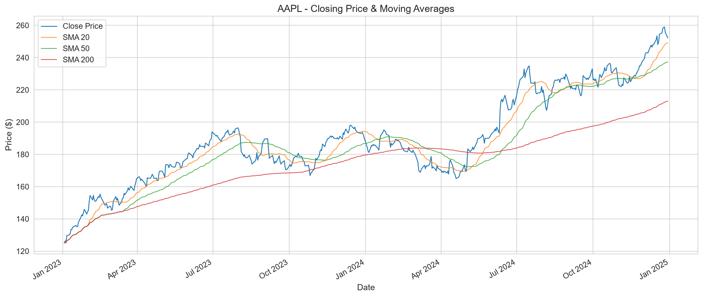
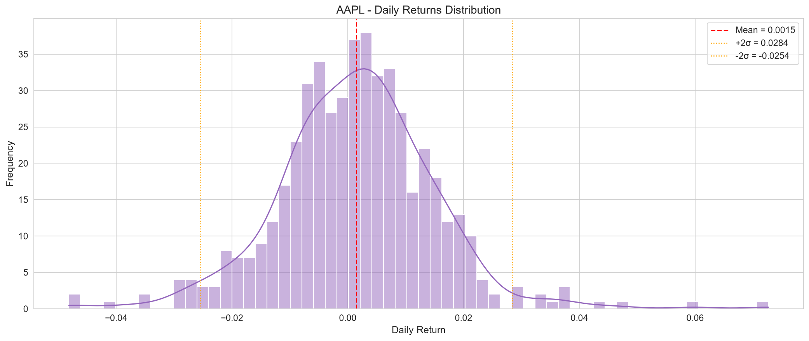
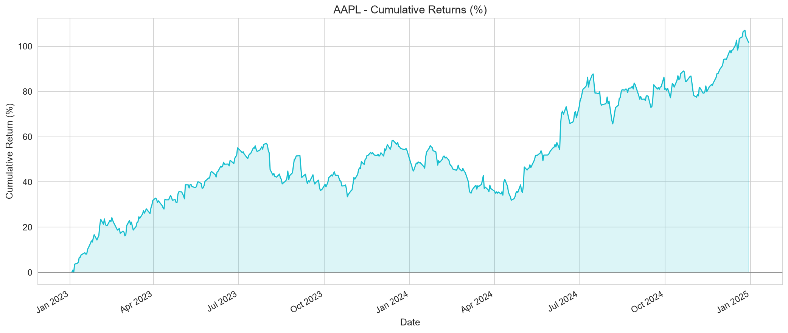
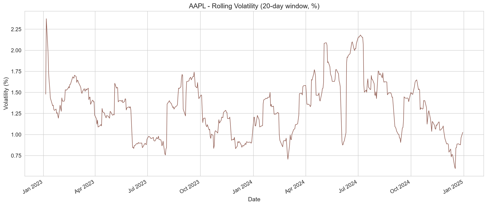
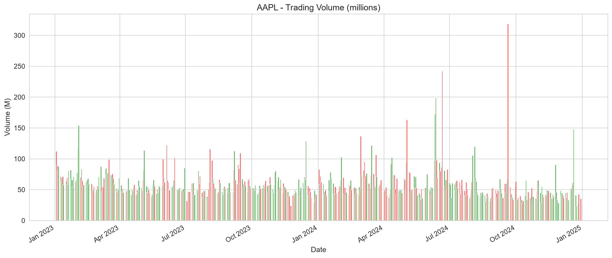
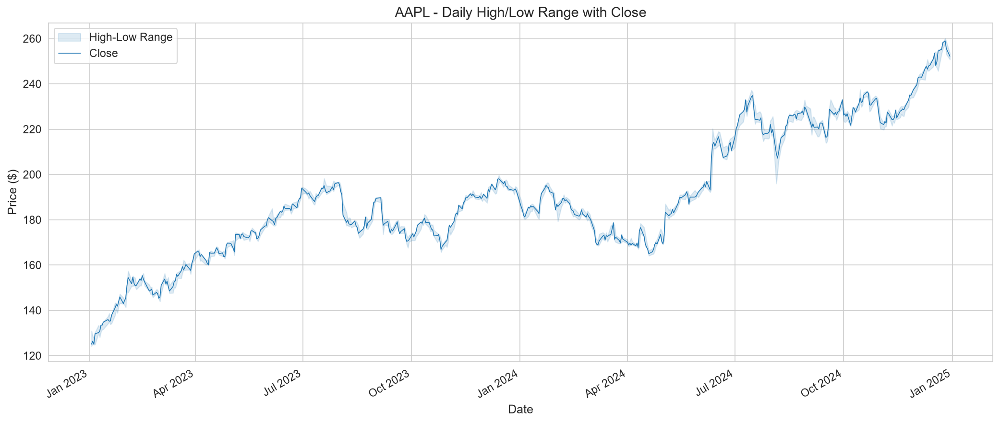
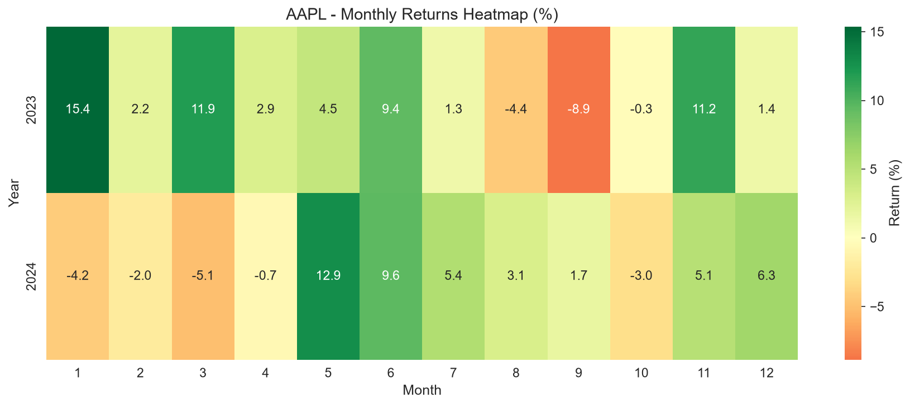
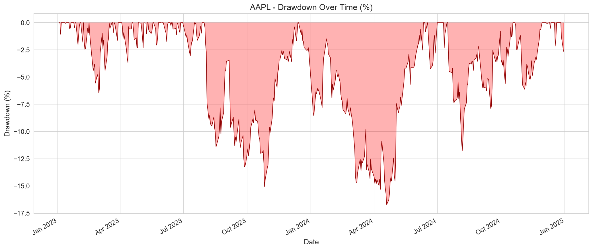
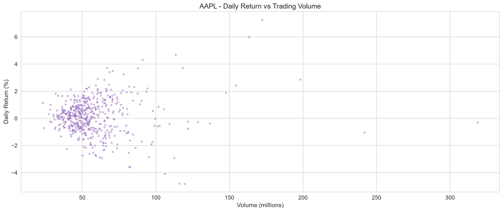

# Stock Analysis Report - AAPL
*Generated on 2026-11-19 15:30:02*

## Price Summary
| Metric | Value |
|---|---|
| Date Range | 2023-01-03 to 2024-12-30 |
| Trading Days | 501 |
| Start Price | $125.07 |
| End Price | $252.20 |
| Highest Price | $259.02 |
| Lowest Price | $125.02 |
| Total Return | 101.65% |

## Risk & Return
| Metric | Value |
|---|---|
| Avg Daily Return | 0.1494% |
| Daily Std Dev | 1.3459% |
| Annualised Return | 42.40% |
| Annualised Volatility | 21.37% |
| Sharpe Ratio | 1.7619 |
| Max Drawdown | -16.71% |

## Technical Levels
| Metric | Value |
|---|---|
| Support | $172.07 |
| Resistance | $214.24 |
| Trend | Uptrend |

## Interpretation
The stock gained 101.7% over the period - a strong performance.
   Annualised volatility of 21.4% indicates MODERATE-to-HIGH risk.
   Sharpe ratio of 1.76 suggests excellent risk-adjusted returns.
   Maximum drawdown of 16.7% shows the worst peak-to-trough loss.
   Current trend signal: Uptrend.

## Charts

---
*Disclaimer: This report is for educational purposes only and is not financial advice.*