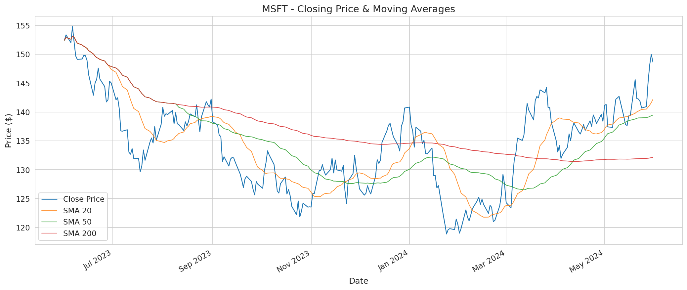
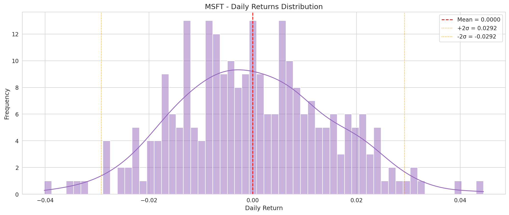
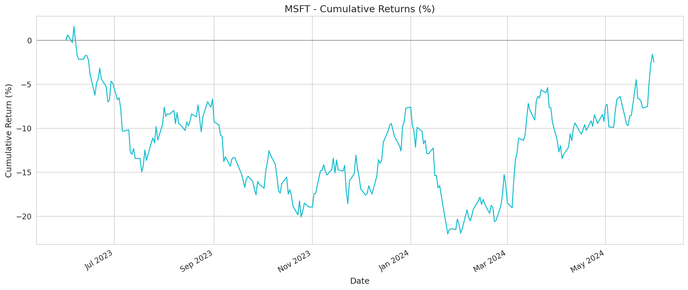
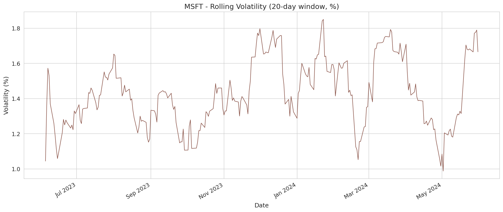
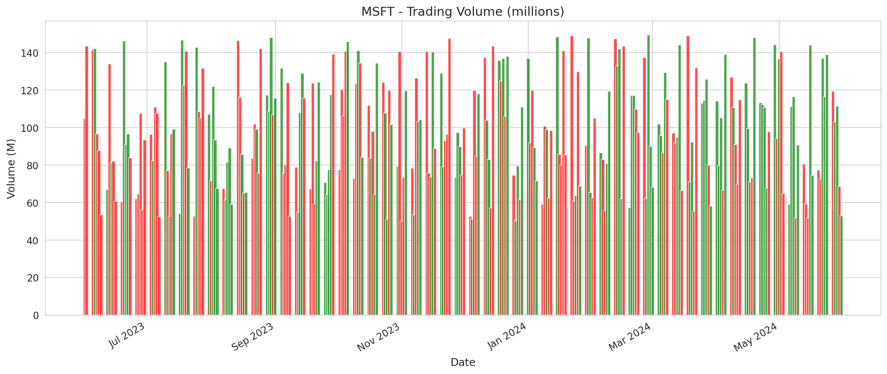
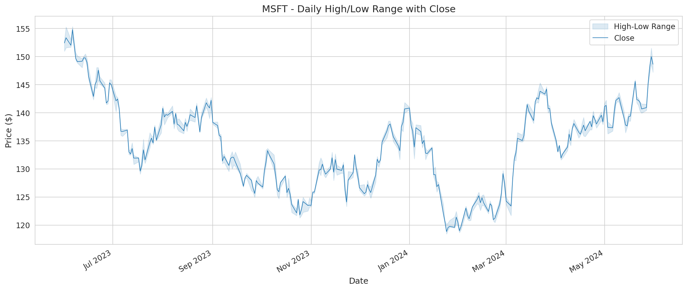
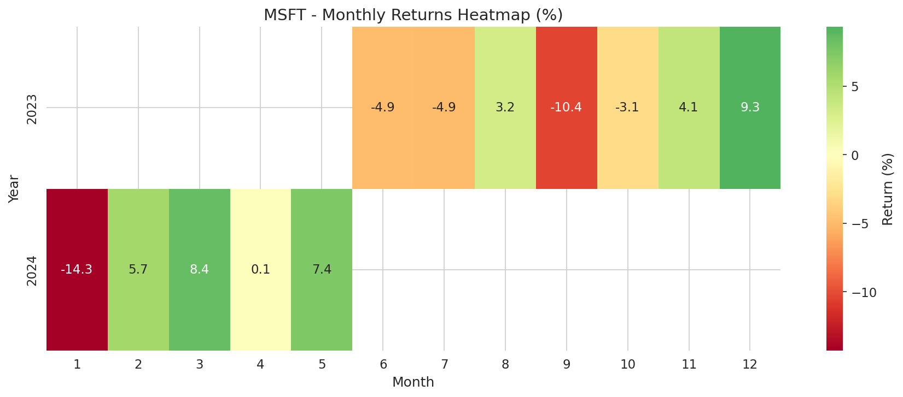
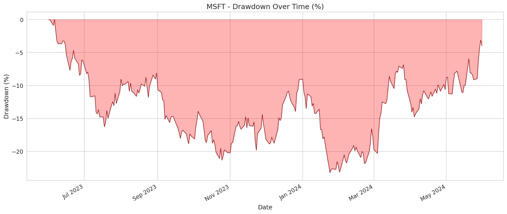
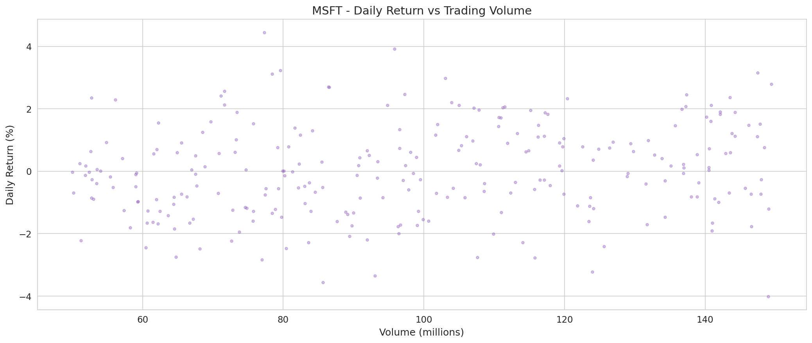

# Stock Analysis Report - MSFT
*Generated on 2026-11-19 14:06:08*

## Price Summary
| Metric | Value |
|---|---|
| Date Range | 2023-06-01 to 2024-05-31 |
| Trading Days | 262 |
| Start Price | $152.43 |
| End Price | $148.64 |
| Highest Price | $154.79 |
| Lowest Price | $118.86 |
| Total Return | -2.49% |

## Risk & Return
| Metric | Value |
|---|---|
| Avg Daily Return | 0.0010% |
| Daily Std Dev | 1.4601% |
| Annualised Return | -2.40% |
| Annualised Volatility | 23.18% |
| Sharpe Ratio | 0.0105 |
| Max Drawdown | -23.21% |

## Technical Levels
| Metric | Value |
|---|---|
| Support | $128.19 |
| Resistance | $139.46 |
| Trend | Uptrend |

## Interpretation
The stock fell 2.5% over the period - a moderate decline.
   Annualised volatility of 23.2% indicates MODERATE-to-HIGH risk.
   Sharpe ratio of 0.01 suggests poor risk-adjusted returns.
   Maximum drawdown of 23.2% shows the worst peak-to-trough loss.
   Current trend signal: Uptrend.

## Charts

---
*Disclaimer: This report is for educational purposes only and is not financial advice.*