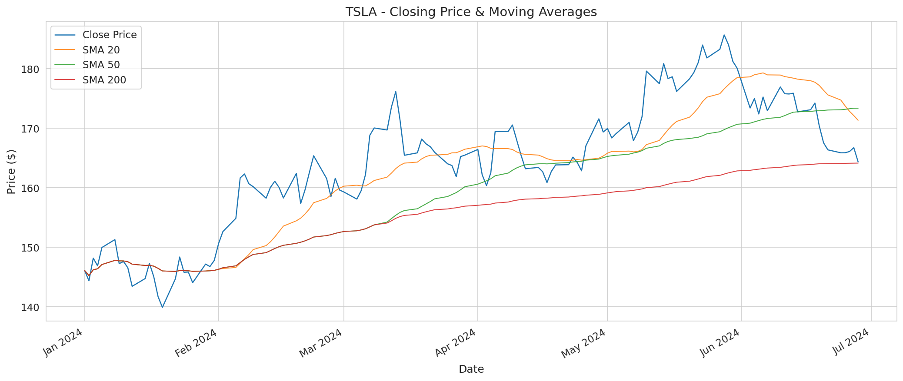
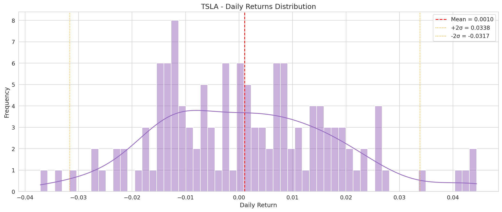
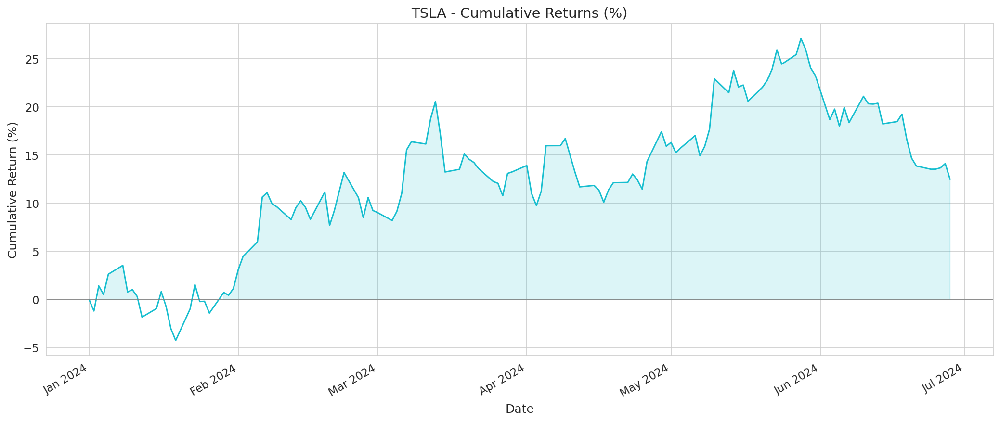
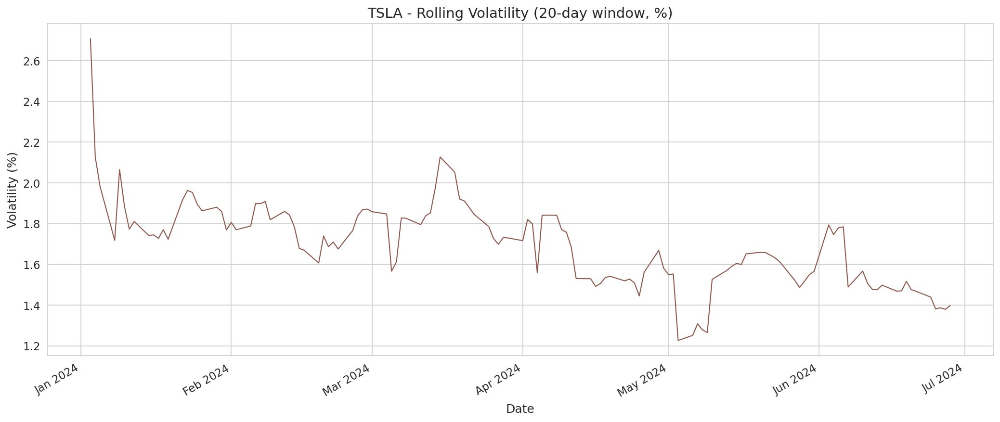
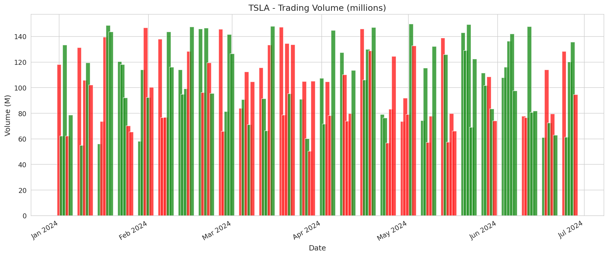
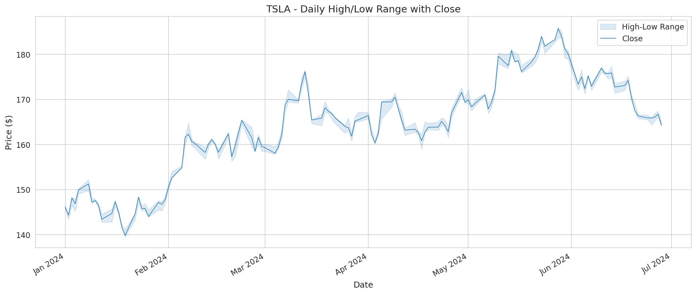
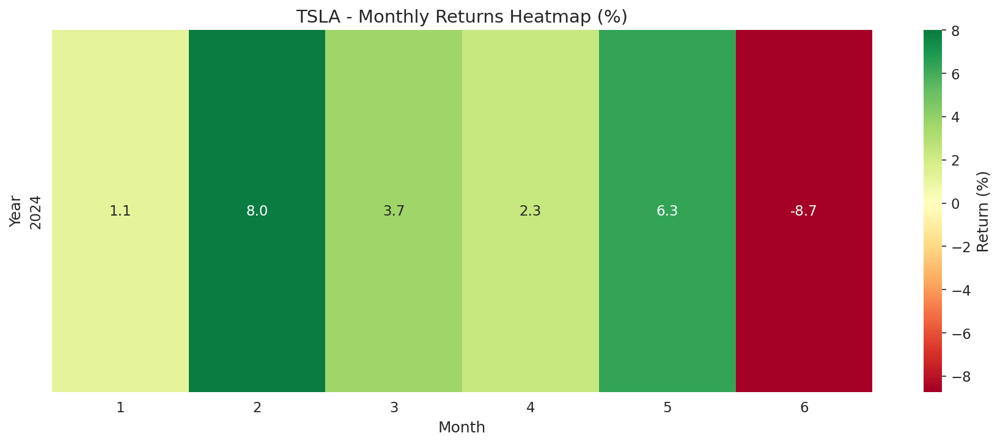
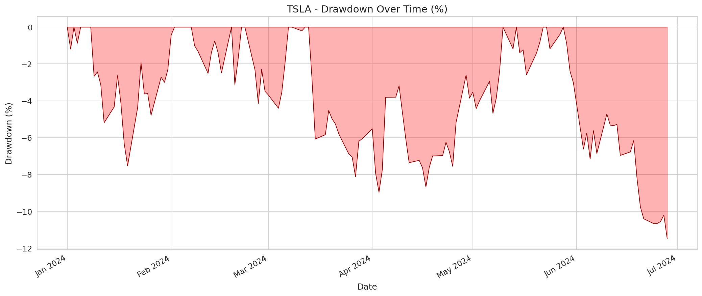
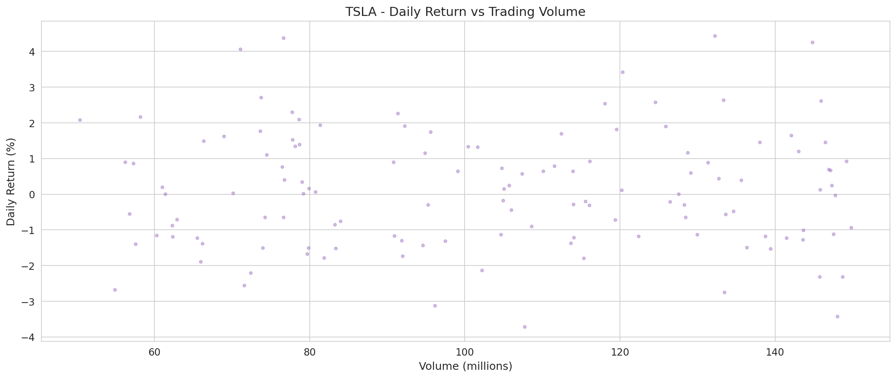

# Stock Analysis Report - TSLA
*Generated on 2026-11-19 14:13:00*

## Price Summary
| Metric | Value |
|---|---|
| Date Range | 2024-01-01 to 2024-06-28 |
| Trading Days | 130 |
| Start Price | $146.11 |
| End Price | $164.35 |
| Highest Price | $185.69 |
| Lowest Price | $139.90 |
| Total Return | 12.48% |

## Risk & Return
| Metric | Value |
|---|---|
| Avg Daily Return | 0.1045% |
| Daily Std Dev | 1.6366% |
| Annualised Return | 25.84% |
| Annualised Volatility | 25.98% |
| Sharpe Ratio | 1.0133 |
| Max Drawdown | -11.49% |

## Technical Levels
| Metric | Value |
|---|---|
| Support | $159.55 |
| Resistance | $171.24 |
| Trend | Uptrend |

## Interpretation
The stock rose 12.5% over the period - a positive but modest gain.
   Annualised volatility of 26.0% indicates MODERATE-to-HIGH risk.
   Sharpe ratio of 1.01 suggests acceptable risk-adjusted returns.
   Maximum drawdown of 11.5% shows the worst peak-to-trough loss.
   Current trend signal: Uptrend.

## Charts

---
*Disclaimer: This report is for educational purposes only and is not financial advice.*